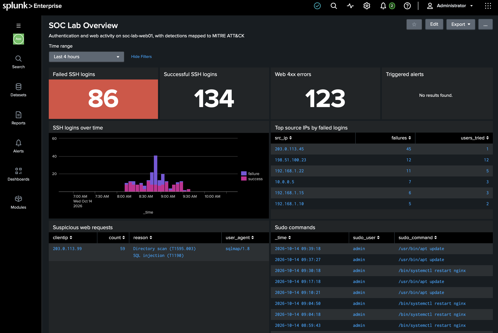
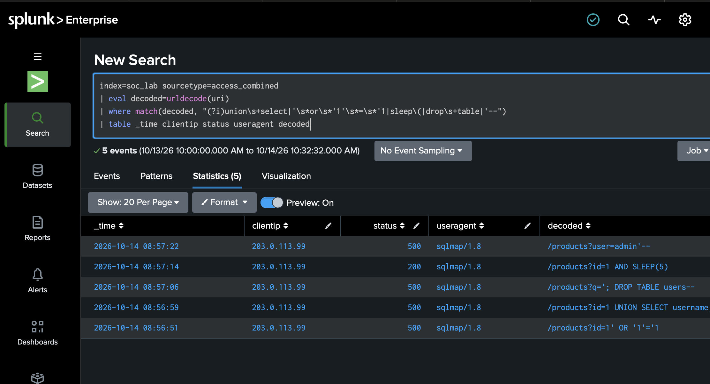
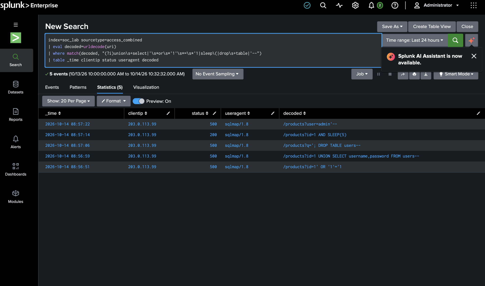
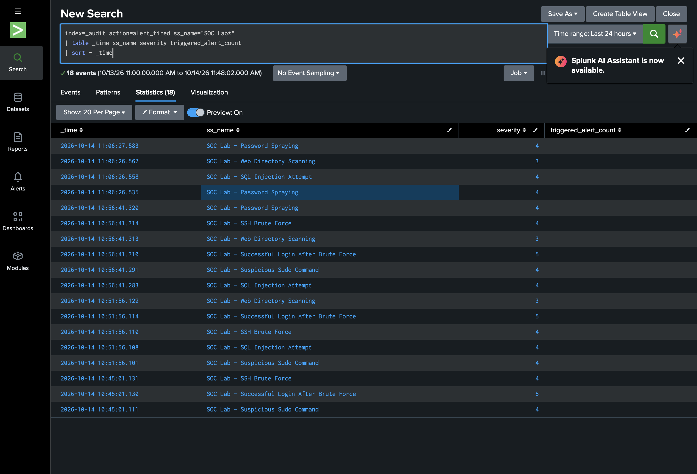
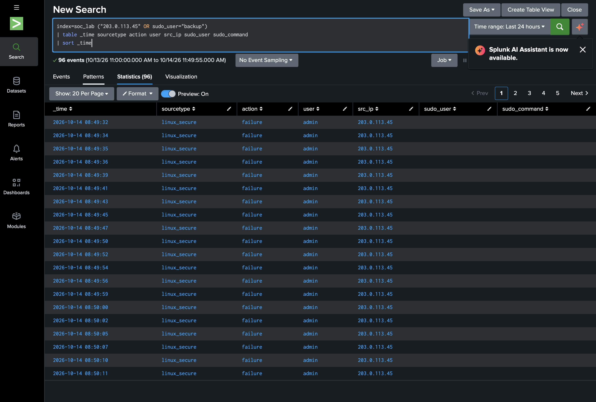

# Home SOC Lab

A small Security Operations Centre I built on my MacBook to practise the day-to-day work of a SOC analyst: collecting logs in Splunk, writing detection rules, triaging alerts and writing up incidents.

A Python script simulates a Linux web server (`soc-lab-web01`). It produces normal SSH logins and website traffic, and mixes in six attacks. Splunk ingests the logs, six scheduled detections catch the attacks, and a dashboard gives a single view of what is happening on the host.



## What it detects

| # | Detection | Log source | MITRE ATT&CK | Severity |
|---|-----------|-----------|--------------|----------|
| 1 | SSH brute force | auth.log | T1110.001 Password Guessing | High |
| 2 | Successful login after brute force | auth.log | T1110, T1078 Valid Accounts | Critical |
| 3 | Password spraying | auth.log | T1110.003 Password Spraying | High |
| 4 | Suspicious sudo command | auth.log | T1548.003 Sudo and Sudo Caching | High |
| 5 | Web directory scanning | access.log | T1595.003 Wordlist Scanning | Medium |
| 6 | SQL injection attempt | access.log | T1190 Exploit Public-Facing Application | High |

The SPL, thresholds and reasoning behind each rule are in [docs/detections.md](docs/detections.md).

## How it fits together

```
log-generator/generate_logs.py
        │  writes
        ▼
logs/auth.log      logs/access.log
        │  monitored by Splunk (inputs.conf)
        ▼
index = soc_lab   (sourcetypes linux_secure, access_combined)
        │
        ├── 6 scheduled detections (savedsearches.conf), every 5 minutes
        │        └── Triggered Alerts
        └── SOC Lab Overview dashboard
```

## Repository layout

```
home-soc-lab/
├── log-generator/generate_logs.py   # simulates normal activity plus 6 attacks
├── splunk/soc_lab/                  # Splunk app: index, field extractions, detections, dashboard
├── detections/                      # each detection as a standalone .spl file
├── docs/
│   ├── setup-guide.md               # step-by-step install on macOS
│   ├── detections.md                # detection logic, thresholds, false positives
│   └── incident-report-IR-001.md    # write-up of the brute force to compromise chain
└── screenshots/
```

## Quick start

```bash
git clone https://github.com/VijayalaxmiKummari/home-soc-lab.git
cd home-soc-lab
python3 log-generator/generate_logs.py
```

Then follow [docs/setup-guide.md](docs/setup-guide.md) to install the Splunk app and point it at the `logs/` folder.

To see the alerts fire in real time:

```bash
python3 log-generator/generate_logs.py --attack-now
```

## Investigation

The most interesting finding is a full attack chain from one IP: 45 failed logins against `admin`, a successful login seconds later, then `sudo cat /etc/shadow` and a script downloaded to `/tmp`. I triaged it as I would in a real SOC and wrote it up in [docs/incident-report-IR-001.md](docs/incident-report-IR-001.md), including the timeline, indicators of compromise and recommended containment steps.

## What I learned

- Thresholds matter. Real users mistype passwords too, so the brute force rule counts failures per source IP inside a 15-minute window rather than per user over the whole day. That keeps the alert on the attacker and off the help desk queue.
- A single alert rarely tells the whole story. Correlating the failed logins with the later successful login and sudo activity is what turns "noisy scanner" into "compromised account".
- Mapping each rule to MITRE ATT&CK made it much easier to explain what each alert means and where it sits in an attack.

## Tools

Splunk Enterprise (free licence), Python 3, SPL, MITRE ATT&CK, macOS

All IP addresses used for attackers come from the reserved documentation ranges (RFC 5737), so none of them belong to real systems.

## Screenshots

| SSH brute force detection | SQL injection detection |
|---|---|
|  |  |

| All six detections firing | Incident timeline (IR-001) |
|---|---|
|  |  |
